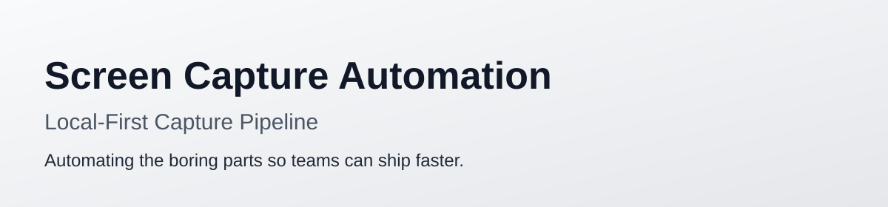
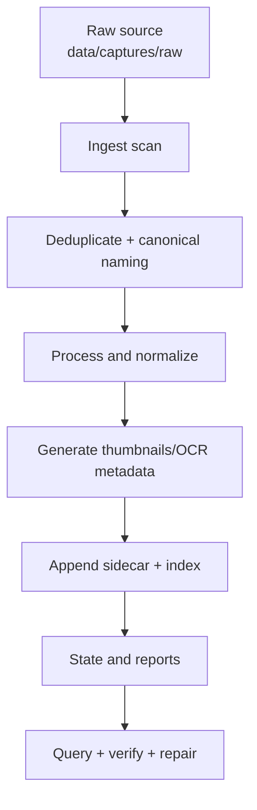

<picture>
  <source media="(prefers-color-scheme: dark)" srcset="docs/assets/dynamic-banner.svg">
  <source media="(prefers-color-scheme: light)" srcset="docs/assets/light-banner.svg">
  
</picture>

<h1 align="center">Media Ark</h1>

<p align="center">
  
  
  
  
  
</p>

<h2 align="center">A local-first media archive pipeline for images, video, PDF, and documents.</h2>

## Table of Contents

- [Problem](#problem)
- [Pro Tier](#pro-tier)
- [Architecture](#architecture)
- [Install](#install)
- [Quick Start](#quick-start)
- [Storage Model](#storage-model)
- [Commands](#commands)
- [Maintenance](#maintenance)
- [Governance](#governance)

## Problem

Raw screenshots, PDFs, photos, recordings, and documents are created faster than they can be curated manually.

This repo provides a resilient, local-first pipeline that converts raw media into:

- canonicalized layouts (image/video/document),
- sidecar metadata,
- OCR/keyword enrichment,
- queryable indexes,
- repairable state.

The brand: **Media Ark** (the "ark" metaphor — a small, intentional, durable collection of heterogeneous things kept safe through disruption). Domain: [media-ark.org](https://media-ark.org). GitHub: [4444J99/media-ark](https://github.com/4444J99/media-ark). Previously: `screen-capture-automation` (renamed 2026-06-10).

## Pro Tier

Media Ark stays useful as a free, local-only repository at [4444J99/media-ark](https://github.com/4444J99/media-ark): your captures, OCR, manifests, indexes, and reports live on your machine under `.media-ark/`, and you decide how to copy or back them up.

For knowledge workers and journalists, the harder problem is not just processing files. It is preserving the material that supports a story, investigation, research brief, client memo, or long-running project when devices fail or work moves across machines. Media Ark Pro adds encrypted cloud sync and backup for **$7/mo** so source material, derived metadata, and searchable context can be recovered without giving up a local-first workflow.

| Tier | Price | Best for | What is included |
| --- | --- | --- | --- |
| Free | $0 | Local-first personal archives, private experiments, and repository-based automation | CLI/API/MCP/dashboard, local processing, local manifests, local indexes, local reports |
| Pro | $7/mo | Knowledge workers and journalists who need durable capture libraries across devices | Everything in Free, plus encrypted cloud sync, encrypted backup, and recovery for the archive state |

See [docs/PRICING.md](docs/PRICING.md) for the full pricing and value-prop notes.

## Architecture



## Install

Media Ark is local-first and dependency-light: the core engine is **pure Python standard library** (no third-party packages to install), and the npm scripts are thin convenience wrappers around the Python CLI and shell tools.

### Requirements

- **Python 3.11+** — required (core engine).
- **Node.js 18+** — optional; only needed for the `npm run …` shortcuts and the one-command platform launcher.
- **Optional enrichment tools** — used when present and silently skipped when absent (the pipeline still runs without them):
  - [`tesseract`](https://github.com/tesseract-ocr/tesseract) — OCR text extraction from images.
  - [`poppler`](https://poppler.freedesktop.org/) (`pdftotext`) — text extraction from PDFs.
  - [`ffmpeg`](https://ffmpeg.org/) / `ffprobe` — video metadata and optional poster frames.

```bash
# macOS (Homebrew)
brew install tesseract poppler ffmpeg

# Debian/Ubuntu
sudo apt-get install tesseract-ocr poppler-utils ffmpeg
```

### Get the code

```bash
git clone https://github.com/4444J99/media-ark.git
cd media-ark
```

That is enough to run everything in [Quick Start](#quick-start) directly with `python3`.

### Optional: install as a package

Installing the project exposes the console entry points (`media-ark`, `media-ark-api`, `media-ark-mcp`) on your `PATH`:

```bash
pip install -e .
```

```bash
media-ark data/captures/raw --out .media-ark --dry-run
```

### Optional: enable the npm shortcuts

```bash
# no dependencies are downloaded; this just makes `npm run …` available
npm install
npm run media-ark:dry-run
```

### Verify the install

```bash
npm run release:verify        # or: python3 tools/media-ark/verify_release.py
npm test                      # or: python3 -m unittest discover -s tests -p 'test_*.py'
```

## Quick Start

### 1) Dry run against local captures

```bash
python3 src/media_ark/process_captures.py data/captures/raw --out .media-ark --dry-run
```

### 2) One-shot ingest + enrich

```bash
./tools/media-ark/run_media_ark.sh data/captures/raw .media-ark --copy
```

### 3) Start unattended watch mode

```bash
./tools/media-ark/media_ark_watch.sh data/captures/raw .media-ark --watch --interval 10 --max-runs 0
```

### 4) Run full check/process/verify cycle

```bash
./tools/media-ark/media_ark_pipeline.sh data/captures/raw .media-ark
```

## Product Surfaces (CLI, API, MCP, Dashboard)

### API + dashboard

Start the platform in one command:

```bash
npm run platform:start
```

The command creates the default source/output directories, preflights the stdio MCP tool contract, then starts the API and dashboard at `http://127.0.0.1:8787/`.

Start UI + API directly:

```bash
python3 -m src.platform.api_server --host 127.0.0.1 --port 8787
```

- Open `http://127.0.0.1:8787/` for the dashboard.
- Register or log in with `POST /api/auth/register` or `POST /api/auth/login`.
- Send `Authorization: Bearer <api_key>` on protected operational API requests.
- `GET /api/status?source=<path>&out=<path>`
- `GET /api/manifest?out=<path>`
- `GET /api/index?out=<path>&limit=<n>&status=<all|processed|duplicate>&media=<all|image|video|document>`
- `POST /api/run` with JSON `{"action":"process|check-source|verify|repair|query","source":"...","out":"..."}`

Local HTTP users are stored in `~/.media-ark/users.db`; each user gets a sandbox
under `~/.media-ark/users/<username>` for API source/output paths.
The full customer API reference, including auth, examples, errors, limits, and
pro export downloads, is in [`docs/api-reference.md`](docs/api-reference.md).

### MCP (stdio)

```bash
python3 -m src.platform.mcp_server
```

Exposed tools:

- `capture_status`
- `capture_check`
- `capture_run`
- `capture_verify`
- `capture_query`

### CLI remains the primary automation engine

```bash
npm run media-ark:run
npm run media-ark:watch
npm run media-ark:pipeline
```

Run verification:

```bash
npm run release:verify
```

## Storage Model

- `data/captures/raw/` — incoming media.
- `src/media_ark/` — core engine (Python package).
- `src/media_ark/__init__.py` — `BRAND_*` constants (single source of truth for the product name, env-var prefix, default data dir, server identity strings, etc.).
- `src/platform/` — API/MCP runtime bridge.
- `tools/media-ark/` — operational wrappers.
- `.media-ark/` — canonical outputs, manifests, indexes, events.
- `.config/` — examples and tooling presets.
- `docs/` — guides and operational references.
- `web/` — dashboard UI shell.
- `pyproject.toml` — Python project metadata; `[project] name = "media-ark"`.

## Brand Module (single source of truth)

The product's identity strings — display name, domain, repo URL, env-var prefix, server identity, npm name, default data dir — are *data*, not strings baked into source. They live in `src/media_ark/__init__.py` as `BRAND_*` constants and are imported by every consumer (config, server, tests, scripts).

```python
from media_ark import (
    BRAND_NAME,        # "media-ark"
    BRAND_DISPLAY,     # "Media Ark"
    BRAND_DOMAIN,      # "media-ark.org"
    BRAND_REPO_URL,    # "https://github.com/4444J99/media-ark"
    BRAND_DATA_DIR,    # ".media-ark"
    BRAND_NPM,         # "media-ark"
    BRAND_PYTHON_PKG,  # "media_ark"
    BRAND_ENV_PREFIX,  # "MEDIA_ARK"
    BRAND_MCP_NAME,    # "media-ark"
    BRAND_SERVER_VERSION,  # "MediaArk/1.0"
    env_key,           # helper: env_key("SOURCE") -> "MEDIA_ARK_SOURCE"
)
```

Renaming the product is a one-file change in `src/media_ark/__init__.py` (and an update to the README h1 / docs that hardcode the display name).

## Commands

```bash
# Query indexed OCR text
python3 src/media_ark/process_captures.py data/captures/raw --out .media-ark --query "meeting"

# Source scan summary only
python3 src/media_ark/process_captures.py data/captures/raw --out .media-ark --check-source

# Health check only
python3 src/media_ark/process_captures.py data/captures/raw --out .media-ark --verify

# Repair drift and stale state
python3 src/media_ark/process_captures.py data/captures/raw --out .media-ark --repair --repair-orphan-assets
```

## Maintenance

- Add hooks via `--post-hook` for downstream enrichment.
- Keep `data/captures/raw/` as the only inbound source.
- Use `--cleanup-raw` carefully (copy mode recommended).
- Use `--event-log` and `--report` for run telemetry.
- API/MCP actions persist telemetry by default to `.media-ark/platform-events.jsonl` and `.media-ark/reports/`.
- Use `MEDIA_ARK_ALLOWED_ROOTS` to restrict API/MCP `source` and `out` paths in deployed environments.

## Governance

- [Contributing](.github/CONTRIBUTING.md)
- [Security](.github/SECURITY.md)
- [Support](.github/SUPPORT.md)
- [Code of Conduct](CODE_OF_CONDUCT.md)
- [License](LICENSE)
- [Changelog](CHANGELOG.md)

## Documentation

- [docs/](docs/README.md)
- [docs/PRICING.md](docs/PRICING.md)
- [docs/CAPTURE_PIPELINE.md](docs/CAPTURE_PIPELINE.md)
- [docs/getting-started.md](docs/getting-started.md)
- [docs/ONBOARDING.md](docs/ONBOARDING.md)
- [docs/troubleshooting.md](docs/troubleshooting.md)
- [docs/RELEASE.md](docs/RELEASE.md)
- [docs/SHIP_EVIDENCE.md](docs/SHIP_EVIDENCE.md)
- [docs/ROADMAP.md](docs/ROADMAP.md)
