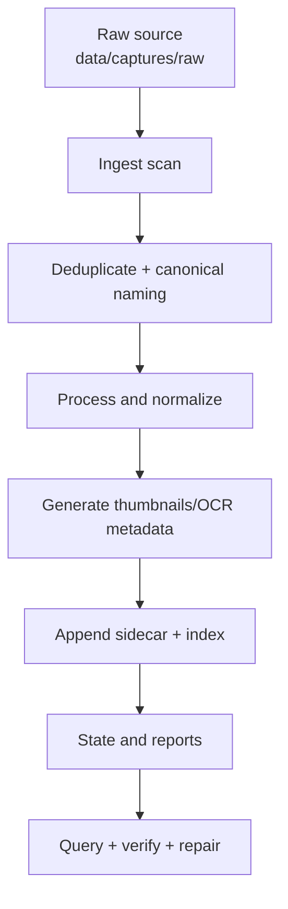

<picture>
  <source media="(prefers-color-scheme: dark)" srcset="docs/assets/dynamic-banner.svg">
  <source media="(prefers-color-scheme: light)" srcset="docs/assets/light-banner.svg">
  
</picture>

<h1 align="center">Screen Capture Automation</h1>

<p align="center">
  
  
  
  
</p>

<h2 align="center">Automates the one-day "cleanup day" into one-hour deterministic loops.</h2>

## Table of Contents

- [Problem](#problem)
- [Architecture](#architecture)
- [Quick Start](#quick-start)
- [Storage Model](#storage-model)
- [Commands](#commands)
- [Maintenance](#maintenance)
- [Governance](#governance)

## Problem

Raw screenshots, PDFs, and recordings are created faster than they can be curated manually.

This repo provides a resilient, local-first pipeline that converts raw captures into:

- canonicalized media layouts,
- sidecar metadata,
- OCR/keyword enrichment,
- queryable indexes,
- repairable state.

## Architecture



## Quick Start

### 1) Dry run against local captures

```bash
python3 src/capture_automation/process_captures.py data/captures/raw --out .capture-automation --dry-run
```

### 2) One-shot ingest + enrich

```bash
./tools/capture-automation/run_capture_automation.sh data/captures/raw .capture-automation --copy
```

### 3) Start unattended watch mode

```bash
./tools/capture-automation/capture_watch_service.sh data/captures/raw .capture-automation --watch --interval 10 --max-runs 0
```

### 4) Run full check/process/verify cycle

```bash
./tools/capture-automation/capture_automation_pipeline.sh data/captures/raw .capture-automation
```

## Storage Model

- `data/captures/raw/` — incoming captures.
- `src/capture_automation/` — core engine.
- `tools/capture-automation/` — operational wrappers.
- `.capture-automation/` — canonical outputs, manifests, indexes, events.
- `.config/` — examples and tooling presets.
- `docs/` — guides and operational references.

## Commands

```bash
# Query indexed OCR text
python3 src/capture_automation/process_captures.py data/captures/raw --out .capture-automation --query "meeting"

# Source scan summary only
python3 src/capture_automation/process_captures.py data/captures/raw --out .capture-automation --check-source

# Health check only
python3 src/capture_automation/process_captures.py data/captures/raw --out .capture-automation --verify

# Repair drift and stale state
python3 src/capture_automation/process_captures.py data/captures/raw --out .capture-automation --repair --repair-orphan-assets
```

## Maintenance

- Add hooks via `--post-hook` for downstream enrichment.
- Keep `data/captures/raw/` as the only inbound source.
- Use `--cleanup-raw` carefully (copy mode recommended).
- Use `--event-log` and `--report` for run telemetry.

## Governance

- [Contributing](.github/CONTRIBUTING.md)
- [Security](.github/SECURITY.md)
- [Support](.github/SUPPORT.md)
- [Code of Conduct](CODE_OF_CONDUCT.md)
- [License](LICENSE)
- [Changelog](CHANGELOG.md)

## Documentation

- [docs/](docs/README.md)
- [docs/CAPTURE_PIPELINE.md](docs/CAPTURE_PIPELINE.md)
- [docs/getting-started.md](docs/getting-started.md)
- [docs/troubleshooting.md](docs/troubleshooting.md)
